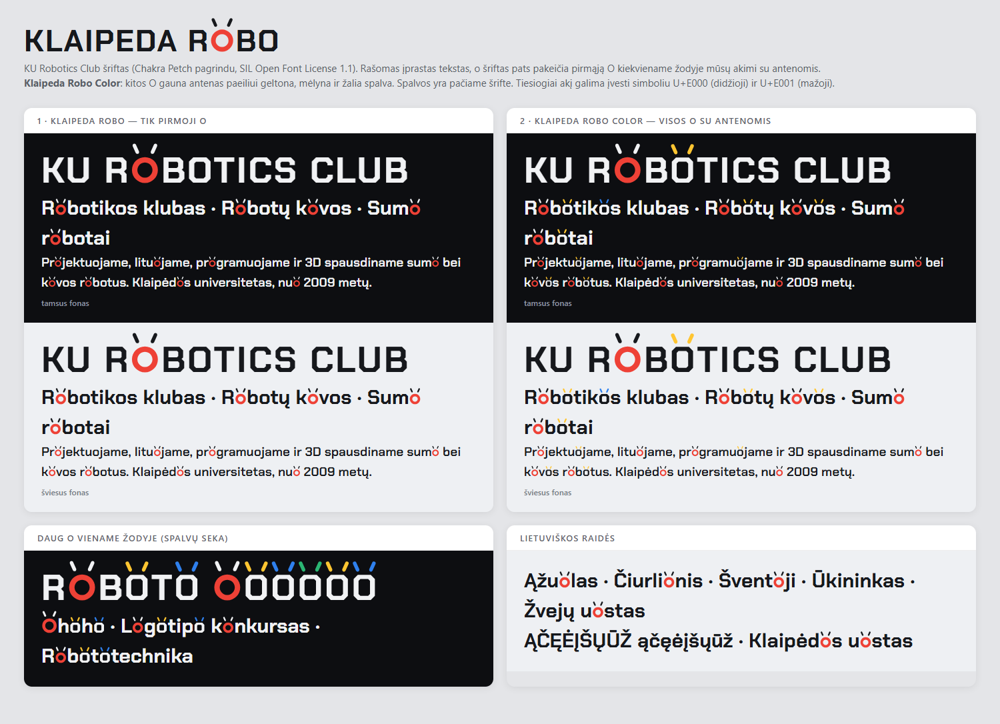

# Klaipeda Robo

**KU Robotics Club** (Klaipėdos universiteto robotikos klubas) šriftas. Rašai paprastą tekstą, o šriftas pats pakeičia pirmąją **O** kiekviename žodyje mūsų robotuko akimi: raudonu žiedu su antenomis.



**Išbandyk naršyklėje:** https://kurobotics.club/sriftas/

## Šriftai

| Šeima | Kas vyksta |
|---|---|
| **Klaipeda Robo** | pirmoji O / o žodyje → akis su antenomis, kitos raidės nepakeistos |
| **Klaipeda Robo Color** | pirmoji O / o → akis; kitos O žodyje gauna antenas paeiliui geltona, mėlyna, žalia spalva |

Storiai: **Bold** ir **SemiBold**. Yra visos lietuviškos raidės.

- `dist/*.ttf`: kompiuteriui (Windows / macOS: dukart spustelėk ir įdiek)
- `dist/*.woff2`: svetainėms

Akį galima įvesti ir tiesiogiai: **U+E000** (didžioji), **U+E001** (mažoji).

### Svetainėje

```css
@font-face {
  font-family: 'Klaipeda Robo';
  src: url(KlaipedaRobo-Bold.woff2) format('woff2');
  font-weight: 700;
}
h1 { font-family: 'Klaipeda Robo', sans-serif; }
```

Taisyklės įrašytos į `calt` ir `rlig`, todėl veikia ir su `letter-spacing` (Chrome tada `calt` išjungia). Spalvos yra šrifte (COLR/CPAL). Programos be spalvotų šriftų palaikymo rodo vienspalvį tos pačios formos kontūrą.

## Kaip sugeneruoti

```bash
pip install fonttools brotli
python build_klaipeda_robo.py
```

Pagrindas: `src/ChakraPetch-Bold.ttf`, `src/ChakraPetch-SemiBold.ttf` (iš [google/fonts](https://github.com/google/fonts/tree/main/ofl/chakrapetch)).

## Licencija

[SIL Open Font License 1.1](OFL.txt). Šriftą galima laisvai naudoti, keisti ir platinti, taip pat komerciniuose darbuose (plakatuose, logotipuose, svetainėse), bet negalima parduoti jo atskirai.

Sukurta pagal **Chakra Petch** (© 2018 The Chakra Petch Project Authors, Cadson Demak). Pakeitimai aprašyti [FONTLOG.txt](FONTLOG.txt).

---

## English

**Klaipeda Robo** is the display typeface of KU Robotics Club (Klaipėda University, Lithuania), derived from Chakra Petch. The first letter O of every word automatically turns into the club's robot eye: a red ring with antennas. **Klaipeda Robo Color** also gives every following O antennas in rotating colours. OpenType `calt` + `rlig`, COLR/CPAL colour layers, full Lithuanian support. Licensed under the SIL Open Font License 1.1.
